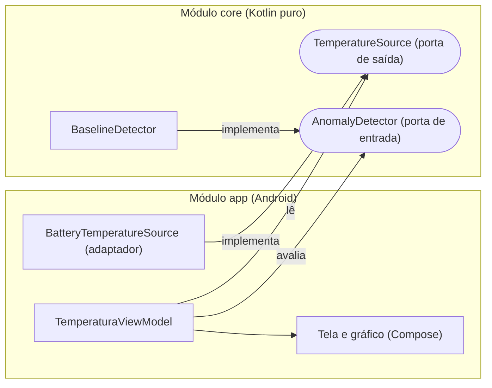
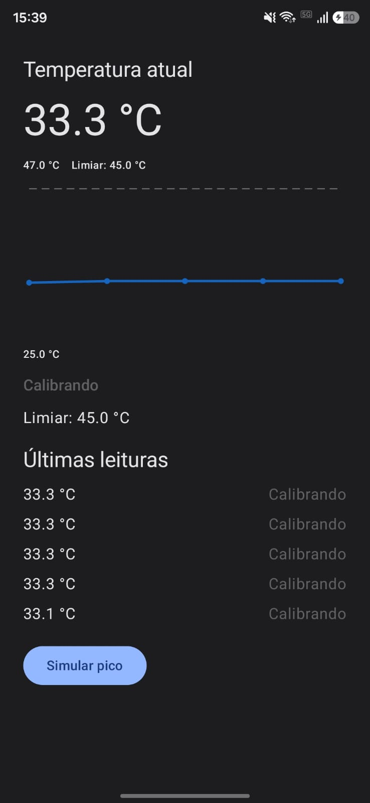

# Hornet | Trilha A | SELDON Missão 01

Repositório da equipe **Hornet** (tema Hollow Knight), Trilha A (Inteligência Artificial), Desafio 01 do SELDON: a fundação de um projeto Android com arquitetura, Git Flow, testes e integração contínua.

## O problema

**Cenário.** Aparelhos Android reduzem o desempenho (thermal throttling) quando esquentam. Em partidas longas de jogos o aquecimento é gradual, e a pessoa só percebe a queda de fluidez quando o sistema já está limitando o aparelho. Falta, dentro do próprio app, uma forma simples de saber se a temperatura da bateria saiu do comportamento recente ou passou de um limite seguro.

**Público.** Pessoas que exigem muito do celular, em especial gamers mobile.

**Objetivo desta fase.** Construir a **linha de base** de detecção de aquecimento anormal, sem modelo de IA. Ela é a referência para comparar modelos no futuro, medindo falsos positivos.

**Como funciona.** Cada leitura de temperatura da bateria é classificada como NORMAL, PICO (subida brusca em relação às últimas 10 leituras, medida por média móvel e desvio padrão), LIMIAR_EXCEDIDO (45 °C ou mais), SEM_BASE (ainda calibrando) ou INVALIDA (valor impossível, como °F lido como °C).

**Requisitos, limites e decisões.** Veja [docs/escopo.md](docs/escopo.md). Resumo dos limites: apenas temperatura da bateria (indicador indireto), sem modelo de IA, sem persistência, sem serviço em segundo plano, sem testes instrumentados.

**Métrica de sucesso.** Em uma série sintética determinística (semente 42, 200 leituras, 5 picos de +6 °C injetados), detectar pelo menos 90% dos picos com no máximo 5% de falsos positivos. A medição é um teste automatizado. Ela comprova o funcionamento do detector, não a eficácia em campo.

## Arquitetura

Dois módulos, em estilo hexagonal leve: `core` (Kotlin puro: regras e interfaces) e `app` (Android: leitura da bateria e interface). O `app` depende do `core`, nunca o contrário.



Detalhes em [docs/arquitetura.md](docs/arquitetura.md). Decisões registradas em [docs/decisoes/](docs/decisoes/): ADR-001 (módulos core e app) e ADR-002 (linha de base com z-score e limiar).

## Como executar

Pré-requisitos: Android Studio com JDK 17 e um aparelho ou emulador Android.

```bash
git clone https://github.com/celiobenj/hornet-seldon.git
cd hornet-seldon
./gradlew assembleDebug testDebugUnitTest :core:test
```

No Windows use `.\gradlew.bat` no lugar de `./gradlew`. O APK de depuração fica em `app/build/outputs/apk/debug/`. Para rodar o app, abra o projeto no Android Studio e execute o módulo `app`.

## Estratégia de branches

- `main`: estável, sem commits diretos. Recebe apenas o PR final de `develop`.
- `develop`: integração das funcionalidades revisadas. Branch padrão.
- `feature/*`: uma tarefa por branch, criada a partir de `develop`.
- Toda mudança entra por Pull Request com uma aprovação de outro integrante e o CI verde.
- Commits atômicos em Conventional Commits.
- Release e hotfix só se houver necessidade real.

## Testes e CI

- O que é testado: conversão de unidades, regras do detector (valores inválidos, limiar, pico, fronteiras de k, piso do desvio, reinício), avaliação em série sintética (detecção e falsos positivos) e o adaptador do app. Plano completo em [docs/testes.md](docs/testes.md).
- Rodar localmente: `./gradlew assembleDebug testDebugUnitTest :core:test`.
- CI: workflow em [.github/workflows/ci.yml](.github/workflows/ci.yml), executado a cada PR para `develop` e `main` e a cada push em `develop`. Gera como artefato o APK de depuração e os relatórios de teste, na aba Actions do GitHub.

## Evidências

- **Métrica na série sintética** (semente 42, 200 leituras, 5 picos de +6 °C): recall de 100% (5 de 5 picos) e 2,70% de falsos positivos (5 de 185 leituras), dentro da meta de pelo menos 90% e no máximo 5%. Reprodução e limitações em [docs/evidencias/metrica-sintetica.md](docs/evidencias/metrica-sintetica.md). Os números vêm de dados sintéticos e não comprovam a eficácia em uso real.
- **CI:** execuções na [aba Actions](https://github.com/celiobenj/hornet-seldon/actions). Cada execução anexa o APK de depuração e os relatórios de teste no artefato `apk-e-relatorios`.
- **Testes manuais:** os casos CT-20 a CT-24 foram registrados pelo QA em [docs/evidencias/ci-e-testes.md](docs/evidencias/ci-e-testes.md), sem capturas de tela por caso.
- **App em aparelho real:** temperatura atual, gráfico com a linha do limiar (45 °C), status e últimas leituras, durante a calibração.



## Contribuições

| Integrante | GitHub | Função | Resumo | Evidências |
|---|---|---|---|---|
| Célio Benjamim | celiobenj | Líder, Backend | Lidera a equipe e define o escopo, o contrato do `core` e o fluxo de Git. Entrega a documentação inicial, a fundação (projeto Android, módulo `core`, CI e ADR-001), a proteção das branches e as revisões dos PRs do app, do ADR-002 e das evidências. | [#18](https://github.com/celiobenj/hornet-seldon/pull/18), [#19](https://github.com/celiobenj/hornet-seldon/pull/19); revisões [#22](https://github.com/celiobenj/hornet-seldon/pull/22), [#24](https://github.com/celiobenj/hornet-seldon/pull/24), [#25](https://github.com/celiobenj/hornet-seldon/pull/25), [#26](https://github.com/celiobenj/hornet-seldon/pull/26), [#28](https://github.com/celiobenj/hornet-seldon/pull/28), [#29](https://github.com/celiobenj/hornet-seldon/pull/29), [#30](https://github.com/celiobenj/hornet-seldon/pull/30) |
| Bruno Bras | Bruno-Bras | Backend | Implementa o detector de linha de base (janela móvel, z-score e limiar) com os 14 vetores do contrato e escreve o ADR-002. | [#23](https://github.com/celiobenj/hornet-seldon/pull/23), [#24](https://github.com/celiobenj/hornet-seldon/pull/24) |
| Eduardo Negreiros | ewmneng25 | Frontend | Implementa a leitura da temperatura da bateria, o ViewModel, a tela e o gráfico em Canvas, e liga o detector real ao app. | [#22](https://github.com/celiobenj/hornet-seldon/pull/22), [#26](https://github.com/celiobenj/hornet-seldon/pull/26), [#28](https://github.com/celiobenj/hornet-seldon/pull/28) |
| David Israel | DavidIsrael1026 | QA, Full Stack | Cria o gerador de série sintética, a avaliação de recall e falsos positivos e a documentação da métrica. | [#20](https://github.com/celiobenj/hornet-seldon/pull/20), [#25](https://github.com/celiobenj/hornet-seldon/pull/25), [#29](https://github.com/celiobenj/hornet-seldon/pull/29) |
| Marcelo Almeida | Marcelo-Heitor-de-Almeida-Lira | QA | Escreve os testes de conversão e de erro de unidade, o plano de testes e o registro das evidências de CI e de testes manuais. | [#21](https://github.com/celiobenj/hornet-seldon/pull/21), [#27](https://github.com/celiobenj/hornet-seldon/pull/27), [#30](https://github.com/celiobenj/hornet-seldon/pull/30) |

As tarefas de cada pessoa estão nas [issues do repositório](https://github.com/celiobenj/hornet-seldon/issues?q=is%3Aissue).

## Apresentação

Representante: Célio Benjamim. Segunda-feira, 23/11/2026, das 10h às 12h. A apresentação percorre este README.
