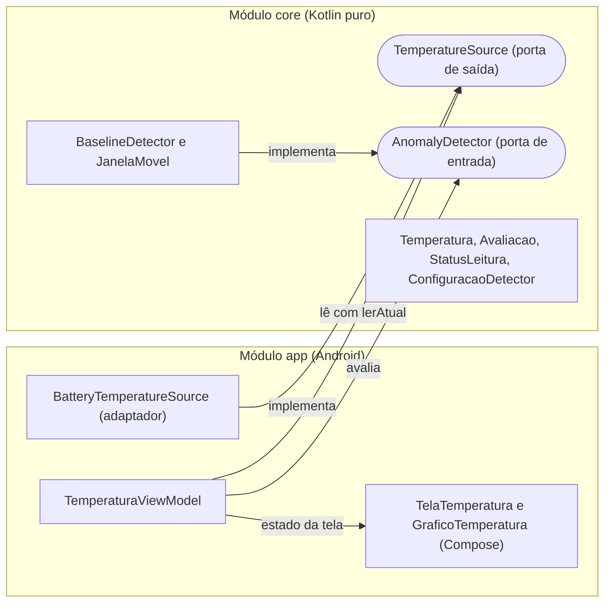

# Arquitetura inicial

Estilo: hexagonal leve com dois módulos. Registro da decisão em [ADR-001](decisoes/ADR-001.md).

## Visão geral

## Fluxo de dados
1. O sistema Android mantém a temperatura da bateria na intent ACTION_BATTERY_CHANGED (valor inteiro em décimos de °C).
2. `BatteryTemperatureSource` (app) lê esse inteiro e o converte com `Temperatura.deDecimosDeCelsius`.
3. A cada 5 segundos o `TemperaturaViewModel` chama `lerAtual()` e entrega a `Temperatura` ao `AnomalyDetector`.
4. O `BaselineDetector` (core) aplica as regras e devolve uma `Avaliacao` (status, média, desvio e z-score).
5. O ViewModel guarda as últimas 60 avaliações em um estado observável.
6. A tela mostra a temperatura atual, o status e a lista. O gráfico desenha a série, a linha do limiar e os pontos anômalos.
7. O botão "Simular pico" injeta uma leitura (atual + 6 °C) pelo mesmo caminho do passo 3.

## Responsabilidades
| Componente | Módulo | Responsabilidade |
|---|---|---|
| `Temperatura` | core | Valor em °C com conversões de °F e décimos de °C. |
| `StatusLeitura`, `Avaliacao` | core | Resultado da classificação de uma leitura. |
| `ConfiguracaoDetector` | core | Parâmetros do detector (janela, k, piso, limiar, faixa) com validação. |
| `AnomalyDetector` | core | Porta de entrada: avaliar uma leitura e reiniciar o estado. |
| `TemperatureSource` | core | Porta de saída: fornecer a leitura atual, se houver. |
| `JanelaMovel`, `BaselineDetector` | core | Janela de leituras, média, desvio e regras de decisão. |
| `BatteryTemperatureSource` | app | Adaptador: lê o Android e entrega `Temperatura`. |
| `TemperaturaViewModel` | app | Orquestra leitura, avaliação, histórico e simulação. |
| `TelaTemperatura`, `GraficoTemperatura` | app | Interface com Compose. |

## Decisões técnicas e justificativas
- **Dois módulos e nenhum outro.** Evita módulos vazios e permite que Backend, Frontend e QA trabalhem em pastas diferentes, reduzindo conflitos de merge.
- **Core em Kotlin puro.** Os testes rodam na JVM, sem emulador, o que torna o CI rápido e a regra de negócio fácil de testar.
- **Portas pequenas.** Só duas interfaces. O app pode trocar a fonte (por exemplo, dados simulados) e o detector (por exemplo, um modelo de IA no futuro) sem mexer no restante.
- **Linha de base antes de IA.** Média móvel com desvio padrão mais um limiar absoluto: simples, explicável e mensurável. Registrada no ADR-002.
- **Pull simples.** `TemperatureSource.lerAtual()` é uma chamada síncrona. O app decide a frequência. Evita coroutines no core.
