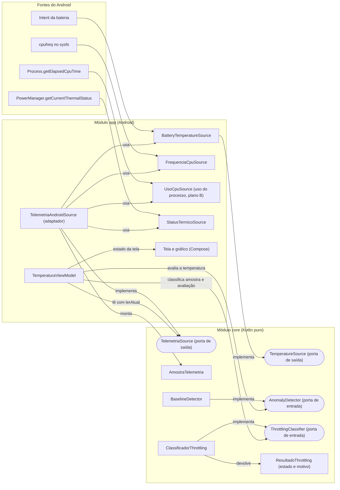

# Arquitetura

Estilo: hexagonal leve com dois módulos. Registro da decisão em [ADR-001](decisoes/ADR-001.md).

## Visão geral

A v1 mede só a temperatura da bateria. A v2 acrescenta frequência da CPU, uso da CPU e status térmico para classificar thermal throttling. O contrato v2 está em [contrato-core.md](contrato-core.md) (seção 6) e as regras de decisão em [classificador-throttling.md](classificador-throttling.md).

## Fluxo de dados
1. O sistema Android mantém a temperatura da bateria na intent ACTION_BATTERY_CHANGED (valor inteiro em décimos de °C).
2. `BatteryTemperatureSource` lê esse inteiro e o converte com `Temperatura.deDecimosDeCelsius`.
3. `FrequenciaCpuSource` lê no sysfs (`cpufreq`) a frequência atual, o teto e o máximo do mesmo grupo de núcleos, o de maior razão atual/máximo.
4. `UsoCpuSource` calcula o uso da CPU do próprio processo entre duas leituras (plano B). Na primeira leitura devolve ausente.
5. `StatusTermicoSource` lê `PowerManager.getCurrentThermalStatus()` no Android 10 ou superior e devolve ausente nas versões anteriores.
6. `TelemetriaAndroidSource` junta tudo em uma `AmostraTelemetria`. Só a temperatura é obrigatória: sem ela, a leitura inteira é ausente. Os demais sinais ausentes ficam nulos.
7. A cada 5 segundos o `TemperaturaViewModel` chama `lerAtual()` e entrega a temperatura da amostra ao `AnomalyDetector`, que devolve uma `Avaliacao`.
8. O ViewModel passa a amostra e a avaliação ao `ThrottlingClassifier`, que aplica as regras na ordem do documento do classificador e devolve um `ResultadoThrottling` (estado e motivo).
9. O ViewModel guarda o histórico recente em um estado observável. A tela mostra o estado de throttling, o motivo, os sinais e o gráfico da temperatura. Sinal ausente aparece como "indisponível".

## Responsabilidades
| Componente | Módulo | Responsabilidade |
|---|---|---|
| `Temperatura` | core | Valor em °C com conversões de °F e décimos de °C. |
| `StatusLeitura`, `Avaliacao` | core | Resultado da classificação de uma leitura. |
| `ConfiguracaoDetector` | core | Parâmetros do detector (janela, k, piso, limiar, faixa) com validação. |
| `AnomalyDetector` | core | Porta de entrada: avaliar uma leitura e reiniciar o estado. |
| `TemperatureSource` | core | Porta de saída: fornecer a leitura atual, se houver. |
| `JanelaMovel`, `BaselineDetector` | core | Janela de leituras, média, desvio e regras de decisão. |
| `AmostraTelemetria` | core | Leitura multi-sinal: temperatura, frequência (atual, teto e máximo), uso da CPU e status térmico. |
| `TelemetriaSource` | core | Porta de saída: fornecer a amostra atual, se houver. |
| `ThrottlingClassifier` | core | Porta de entrada: classificar a amostra com a avaliação da temperatura. |
| `EstadoThrottling`, `ResultadoThrottling` | core | Estado final (indeterminado, normal, aquecendo, throttling provável ou confirmado) e motivo em português. |
| `ClassificadorThrottling`, `ConfiguracaoThrottling` | core | Regras de decisão e seus parâmetros. |
| `BatteryTemperatureSource` | app | Adaptador: lê o Android e entrega `Temperatura`. |
| `FrequenciaCpuSource` | app | Adaptador: frequência atual, teto e máximo via cpufreq. |
| `UsoCpuSource` | app | Adaptador: uso da CPU do próprio processo (plano B). |
| `StatusTermicoSource` | app | Adaptador: status térmico do `PowerManager`. |
| `TelemetriaAndroidSource` | app | Implementa `TelemetriaSource` compondo os adaptadores. |
| `TemperaturaViewModel` | app | Orquestra leitura, avaliação, classificação, histórico e simulação. |
| `TelaTemperatura`, `GraficoTemperatura` | app | Interface com Compose. |

## Decisões técnicas e justificativas
- **Dois módulos e nenhum outro.** Evita módulos vazios e permite que Backend, Frontend e QA trabalhem em pastas diferentes, reduzindo conflitos de merge.
- **Core em Kotlin puro.** Os testes rodam na JVM, sem emulador, o que torna o CI rápido e a regra de negócio fácil de testar.
- **Portas pequenas.** Poucas interfaces (`TemperatureSource`, `TelemetriaSource`, `AnomalyDetector` e `ThrottlingClassifier`). O app pode trocar as fontes (por exemplo, dados simulados) e o classificador (por exemplo, um modelo de IA no futuro) sem mexer no restante.
- **Linha de base antes de IA.** Média móvel com desvio padrão mais um limiar absoluto: simples, explicável e mensurável. Registrada no ADR-002.
- **Vários sinais, uma decisão.** A temperatura sozinha não indica throttling. Frequência, uso da CPU e status térmico confirmam o que a temperatura sugere. Sinal ausente não gera exceção: a regra que depende dele é ignorada.
- **Uso da CPU do processo.** `/proc/stat` e `/proc/loadavg` não são legíveis por aplicativos comuns. O uso medido é o do próprio app, o que vale como sinal quando a carga vem do próprio app. Ver [validacao/uso-cpu.md](validacao/uso-cpu.md).
- **Pull simples.** `TemperatureSource.lerAtual()` e `TelemetriaSource.lerAtual()` são chamadas síncronas. O app decide a frequência. Evita coroutines no core.
